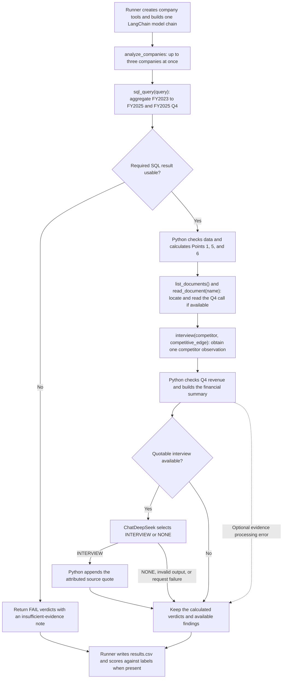

# FTEC5660 Homework 3: Fisher's 15-Point Investment Agent

Build a LangChain agent that researches a company with tools and applies the
framework from Philip Fisher's *Common Stocks and Uncommon Profits* (Part One,
Chapter 3 "What to buy: the fifteen points to look for in a common stock", and
Chapter 4 "What to buy: applying this to your own needs"). You choose 3 of
Fisher's 15 points and decide yourself what PASS means for each. For every
company your agent gives a PASS/FAIL verdict on your 3 points and a short
summary.

The companies are fictional, so the model cannot answer from memory. Unlike a
pile of reports, the evidence is spread over three sources, and your agent has
to go and get it with tools, the way Fisher's "scuttlebutt" method sends an
investor to talk to customers, competitors, suppliers and staff.

## Data and tools

`public_test/` has one folder per company. Your code receives four tools per
company (built by the provided code in `hw3.py`):

| Tool | What it gives you |
| --- | --- |
| `list_documents()` | the company's six documents and their dates |
| `read_document(name)` | one document: the 2025 letter to shareholders, four earnings calls (Q3 2025 to Q2 2026) and a news file (July 2025 to July 2026) |
| `sql_query(query)` | one read-only SQLite query on the company's database; at most 50 rows come back, so use `SUM`, `GROUP BY` and `WHERE` |
| `interview(role, topic)` | what one person says about the company; at most **10 interviews per company** |

The documents are what management says. Management's own claims (such as "we
have never cut research" or "our people are our greatest strength") are not
evidence on their own: check them against the database and the interviews.

**Database tables** (amounts in USD thousands; dates `YYYY-MM-DD`, months
`YYYY-MM`, quarters like `2025Q3`; the fiscal year is the calendar year):

| Table | Columns |
| --- | --- |
| `company` | name, industry |
| `industry_medians` | industry, revenue_growth_2y_pct, new_product_share_pct, new_product_sales_per_rd, operating_margin_pct (one row per industry; use the row for the company's own industry) |
| `orders` | order_id, order_date, product, customer, amount, note (about 3,000 to 4,000 orders from January 2023 to June 2026; revenue is the sum of order amounts) |
| `products` | product, launch_date |
| `monthly_costs` | month, cost_of_sales, selling_admin, research_development |
| `quarterly_cash` | quarter, operating_cash_flow, capex, cash_end |
| `capex_plan` | year, planned_capex (2026 to 2028) |
| `returns` | month, units_shipped, units_returned |
| `insider_trades` | trade_date, person, title, side (`buy` or `sell`), shares, price |

**Terms used in the data.**

| Term | Meaning |
| --- | --- |
| FY2025 | Fiscal year 2025. Here the fiscal year is the calendar year, so FY2025 is January to December 2025. |
| Quarter | Three months of the year: Q1 is January to March, Q2 April to June, Q3 July to September and Q4 October to December. The database writes `2025Q3`; the documents write "third quarter 2025". |
| Amounts | The database is in **USD thousands** (676,100 means US$676.1 million). The documents use USD millions. |
| Revenue | Money from sales: the sum of `amount` in `orders`. |
| Cost of sales | The cost of making the products that were sold. |
| Selling and admin | The cost of selling and of running the company (sales staff, offices, management). |
| R&D | Research and development spending, mainly on new products. |
| Operating margin | Operating profit as a share of revenue: (revenue − cost of sales − selling and admin − R&D) ÷ revenue. |
| Operating cash flow | Cash that the day-to-day business brings in during a quarter. |
| Cash at the end of a quarter | The cash the company holds on the last day of that quarter (`cash_end`). |
| Capex | Capital expenditure: spending on factories, machines and other long-term assets. `capex_plan` holds the planned capex for 2026 to 2028. |
| Return rate | Units returned ÷ units shipped, from the `returns` table. |
| Industry median | The middle value for companies in the same industry, from `industry_medians`. |
| Insider | A director or senior manager of the company. `insider_trades` lists the shares they bought (`buy`) or sold (`sell`). |
| Earnings call | A meeting each quarter where management presents the quarter's results to investors. Each call quotes that quarter's revenue. |

**Interviews.** Roles: `customer`, `current_employee`, `former_employee`,
`competitor`, `supplier`. Topics: `sales_team`, `working_conditions`,
`top_management`, `decision_making`, `competitive_edge`. Only some people know
about each topic; the others say they can't comment, and that answer still
uses up one interview.

| Topic | Who knows about it |
| --- | --- |
| `sales_team` | customer, competitor |
| `working_conditions` | current_employee, former_employee |
| `top_management` | former_employee, supplier |
| `decision_making` | supplier, customer |
| `competitive_edge` | competitor, customer |

People who know about a topic always agree with each other, so one good answer
is enough.

## Choose your 3 points and your rules

Pick any 3 of Fisher's 15 points and write them in `CHOSEN_POINTS` near the
top of `hw3.py`, e.g. `CHOSEN_POINTS = [1, 7, 15]`. The full questions are in
`FISHER_POINTS` in `hw3.py` and in the book.

| # | Fisher's point | Where the evidence is |
| --- | --- | --- |
| 1 | Market potential for sales growth | database |
| 2 | New products as current lines mature | database |
| 3 | Effective research and development | database |
| 4 | Above-average sales organization | interviews (`sales_team`) |
| 5 | Worthwhile profit margin | database |
| 6 | Maintaining or improving margins | database |
| 7 | Labour and personnel relations | interviews (`working_conditions`) |
| 8 | Executive relations | interviews (`top_management`) |
| 9 | Depth of management | interviews (`decision_making`) |
| 10 | Cost analysis and accounting controls | earnings calls, checked against the database |
| 11 | Advantage over competitors | interviews (`competitive_edge`) |
| 12 | Long-range outlook on profits | database |
| 13 | Growth without dilutive equity financing | database |
| 14 | Management talks freely about troubles | earnings calls, checked against the database |
| 15 | Management of unquestionable integrity | news file, checked against the database |

For each of your points, **you design the rule**: which evidence to use, what
to compute or whom to ask, and where the line between PASS and FAIL lies. PASS
means the company looks favourable on that point, as Fisher would see it.

We grade your verdicts against our own answer key. It uses one fixed rule per
point, which we do not publish, and the data never puts a company close to
the line of that rule, so a sensible reading of Fisher usually gives the same
answer. **Test your rules on the public answers**:
`public_test/ground_truth.json` gives the expected verdict on all 15 points
for each of the 20 public companies, and every point fails in 6 of them. If
your rule disagrees with the public answers, rethink it.

**Tip: calculate with tools, not in your head.** Do every sum, ratio and
comparison in SQL or Python, including the number of days between two dates
(SQLite's `julianday()` gives a date as a number of days).

## Student task

Fill in the three places in `hw3.py` marked `### YOUR CODE HERE`. You may add
imports, constants and helper functions above them, but do not change the
provided code below them:

- `CHOSEN_POINTS` lists your 3 points.
- `build_agent()` creates your model and anything else you need once.
- `analyze_companies(agent, companies)` receives
  `{company_folder: [list_documents, read_document, sql_query, interview]}`
  and returns, for every company,
  `{"points": {1: "PASS", 7: "FAIL", 15: "PASS"}, "summary": "..."}` (here with
  `CHOSEN_POINTS = [1, 7, 15]`).

Use the course techniques that fit your points: tool use for the database and
the interviews, planning which interviews to spend, routing each point to the
right source, prompt chaining, parallel calls, reflection to check your
answers, or a combination. Your code must read company data **only through
the four tools**; do not open `company.db` or `interviews.dat` yourself. Do
not hard-code folder names, company names or the public answers.

## Setup and public test

```bash
python3 -m venv .venv
source .venv/bin/activate
pip install -r requirements.txt
echo "DEEPSEEK_API_KEY=your_key_here" > .env
python3 hw3.py --data-folder public_test
```

Use your own DeepSeek API key (from https://platform.deepseek.com). The
required model is `deepseek-v4-flash`. We grade with our own key, so never put
a key in your code; `.env` must stay out of git.

The program creates `results.csv` with the columns `company`, `points`,
`points_correct`, `point_errors`, `interviews_used` and `summary`, and prints
the point score on your 3 points (the percentage after "balanced"). The point
score is the average of two shares: the share of truly passing verdicts that
you marked PASS and the share of truly failing verdicts that you marked FAIL.
For example, 90% and 60% give (90% + 60%) / 2 = 75%, and marking every point
PASS gives (100% + 0%) / 2 = 50%. Once `CHOSEN_POINTS` is set, the starter
runs before you add any API code (it returns no verdicts, so it scores 0%).

`public_test/ground_truth.json` gives the expected verdicts on all 15 points
for each public company. Grading uses a private set of about 20 unseen
companies with the same tools and the same answer key rules, but different
names and wording, and scores your 3 points only.

## Homework 3 solution

### My 3 points and rules

Points 1, 5, and 6 address sales growth, the level of profitability, and whether margins hold up over time. The assignment provides order, cost, and industry data for all three. A shared query supports three separate judgments.

| Point | Why I chose it and evidence used | PASS rule |
| --- | --- | --- |
| **1. Sales growth potential** | Historical sales growth gives a measurable proxy for market potential. I sum FY2023 and FY2025 order amounts and use `company.industry` to select the corresponding `industry_medians.revenue_growth_2y_pct`. | Cumulative revenue growth from FY2023 to FY2025 must be positive and at least as high as the industry benchmark. The calculation is `100 × (FY2025 revenue − FY2023 revenue) / FY2023 revenue`. |
| **5. Worthwhile profit margin** | Comparing with the company's industry gives the margin an economic reference point. I use FY2025 order revenue and the three cost fields in `monthly_costs`, then compare with `industry_medians.operating_margin_pct`. | The FY2025 operating margin must be positive and at least as high as the industry median. |
| **6. Maintaining or improving margins** | A strong margin in one year can coexist with margin erosion. I calculate operating margins for FY2023, FY2024, and FY2025 from the same revenue and cost fields. | The FY2025 operating margin must be at least the FY2023 margin. FY2024 appears in the summary when available and provides context for the change. |

Operating margin (%) is `100 × (revenue − cost of sales − selling and admin − R&D) / revenue`. Each annual revenue total requires 12 order months, non-null amounts, and positive total revenue. Each annual margin also requires 12 distinct monthly cost records and all three cost fields. A point receives **FAIL** if it fails its rule or if its required evidence is unavailable. The summary identifies insufficient evidence when that is the reason.

### Design



Python calls the four supplied LangChain tools with `.ainvoke()`. One read-only SQL query aggregates orders and monthly costs separately by period and looks up the company's industry benchmarks. Python parses the results and uses `Decimal` for the calculations and verdicts. It then checks whether the Q4 FY2025 earnings-call revenue agrees with the SQL total after aligning units and reporting precision. A LangChain prompt chain with `ChatDeepSeek` and a string output parser uses `deepseek-v4-flash` to select whether the competitor observation belongs in the summary. Python accepts `INTERVIEW` and appends the source quote with attribution, or keeps the deterministic summary when the quote or model response is unusable. Python fixes the verdicts before the model selects a quote. The runner loads the public labels after the company analyses are complete.

### Results

The official run on `public_test` processed **20 companies** in **5.593 seconds** and returned **60/60 correct verdicts** and **100.0% balanced accuracy**. All **20** model requests succeeded, and **32 offline tests** passed.

| Point | Correct | True PASS correct | True FAIL correct | Balanced accuracy |
| --- | ---: | ---: | ---: | ---: |
| 1 | 20/20 | 14/14 | 6/6 | 100.0% |
| 5 | 20/20 | 14/14 | 6/6 | 100.0% |
| 6 | 20/20 | 14/14 | 6/6 | 100.0% |

**All companies matched the public labels.** One evidence conflict was recorded. Bramble Labs reported **USD 70.5 million** of Q4 revenue, while the order totals returned **USD 65.6219 million**. The summary flagged the discrepancy, and all three verdicts matched the public labels.

### Limitations

The schema names a two-year growth benchmark and leaves its calculation convention unspecified. Point 1 assumes a cumulative percentage, and historical growth is a proxy for future market potential. Point 6 compares the first and last years, so it can pass a company whose margin fell from FY2024 to FY2025. Statements with ambiguous periods or units are marked unverified. Missing required financial evidence produces a conservative FAIL, which could penalize a company with incomplete records. The public results cover one run on the provided sample. Confirming the growth benchmark's definition and checking how the rules behave with incomplete coverage would provide stronger evidence of generalization.
